  

  
  

I work on both sides of security: I build detection and hardening tooling for defenders, and I break things on authorized engagements.

I founded **[CyberLegionnaire](https://cyberlegionnaire.com)**, a security consultancy whose clients include a financial regulatory firm and a REIT. For them, we provide security monitoring, defense-in-depth hardening and security awareness training, and support their cybersecurity compliance with the Ontario Securities Commission (comparable to the SEC's cyber disclosure rules and SOC 2 controls in the US).

Outside of client work, I build small, practical software, mostly for myself and occasionally for other people.

### 🛡️ Featured work

| Project | What it does | Stack |
|---|---|---|
| **[Wishday](https://github.com/cybersecurityhandle/wishday)** | An Android app that remembers birthdays and wishes people for you, by automatic SMS or a prefilled Signal message. Private by design: no internet permission, no tracking. [v1.1 release](https://github.com/cybersecurityhandle/wishday/releases/tag/v1.1) | Kotlin · Jetpack Compose |
| **[Wazuh-Additions](https://github.com/cybersecurityhandle/Wazuh-Additions)** | Integrates ClamAV malware scanning into Wazuh, so AV detections land in the SIEM next to everything else | Python · Wazuh |
| **[wazuh-lynis](https://github.com/cybersecurityhandle/wazuh-lynis)** | Runs Lynis hardening audits on Wazuh agents and turns the findings into alerts | Python · Wazuh |
| **[pan-redactor](https://github.com/cybersecurityhandle/pan-redactor)** | Finds payment card numbers in logs and exports, validates them with the Luhn checksum and masks them to PCI DSS rules, entirely in the browser. [Try it](https://cybersecurityhandle.github.io/pan-redactor/) | JavaScript · HTML |
| **[tor-ovh](https://github.com/cybersecurityhandle/tor-ovh)** | Terraform that rebuilds an OVH dedicated server as a hardened, non-exit Tor relay, with a locked-down firewall and automatic security updates | Terraform · Bash · Tor |
| **[stuckless-net](https://github.com/cybersecurityhandle/stuckless-net)** | My personal hub, [stuckless.net](https://stuckless.net). It has a live threat intel page (newest CVEs, CISA's list of actively exploited vulnerabilities, exploit probability scores and MITRE ATT&CK threat groups) and investing tools built on attributable earnings | TypeScript · Next.js · Redis |

### 🧰 Toolbox

  
  
  
  
  
  
  
  
  
  
  
  
  

**Defence:** SIEM/XDR (Wazuh), vulnerability management, host hardening, DFIR 
**Offence:** web and network pentesting, AD attacks, privilege escalation, recon automation

### 📫 Get in touch

For security work, see **[cyberlegionnaire.com](https://cyberlegionnaire.com)** or email [daniel@cyberlegionnaire.com](mailto:daniel@cyberlegionnaire.com).

All offensive work is done with authorization. Please report issues in my repos through GitHub Issues.
